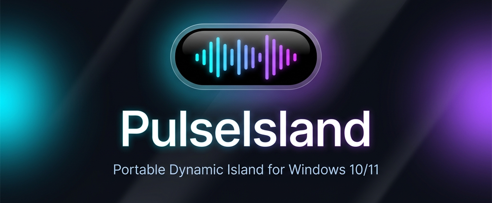
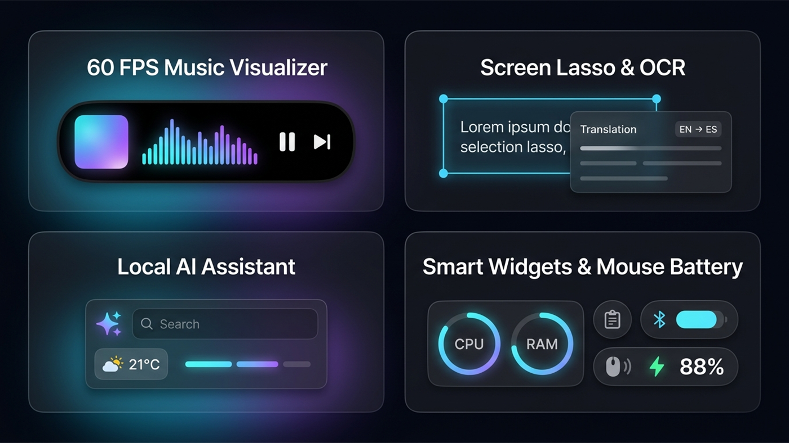

<p align="center">
  
</p>

<p align="center">
  
  
  
  
  
  
  
</p>

# PulseIsland v2.0

**PulseIsland** is a lightweight, 100% portable ("Zero-Install") Windows 10/11 desktop app (`.NET 8 WPF`) that brings a top-edge **Dynamic Island** experience to Windows — uniting a live 60 FPS audio visualizer, live microphone & audio output controls, system notifications, neural screen OCR & offline translation, a multimodal local AI assistant with offline voice dictation, and wireless hardware telemetry.

Built from the ground up to:
1. **Work out of the box** on any Windows PC — no installer required, zero external NuGet dependencies by default (`FullSdk=false`), zero automatic background model downloads, and zero files written to `%AppData%` or `%LocalAppData%`.
2. **Be effortlessly customizable with AI coding agents** — includes [`AGENT.md`](AGENT.md), [`GOAL.md`](GOAL.md), and modular agent skills in [`.agents/skills/`](.agents/skills/) so any AI assistant (Antigravity, Cursor, Claude Code, Codex, etc.) immediately understands the architecture, guardrails, and build/test pipeline.

---

## Features

<p align="center">
  
</p>

- **Dynamic Island UI, 3-Step Onboarding & Live Bilingual UI (EN ⇄ RU):**
  - `Hidden` / `Compact` / `Expanded` states, real Windows DWM acrylic backdrop blur, 7 built-in themes, custom corner radius & opacity, and smooth transitions.
  - **English by default** with instant live switching to Russian (no restart) both on Step 1 of the 3-step `WelcomeOnboardingWindow` and in Settings. Reopen the onboarding wizard anytime via the **Guide** button in Settings.
- **Live Activities in the Island:**
  - **Active Microphone Capture Pill:** Displays which app is actively using your microphone (e.g., Discord, OBS, Teams) in both Compact & Expanded states with a **1-click Mute** toggle.
  - **1-Click Audio Output Switcher:** Switch the Windows default playback endpoint directly from the island via COM `IPolicyConfig`, displaying real device names via `IPropertyStore`.
  - Intentionally clean and focused — no Timer/Pomodoro/Stopwatch clutter.
- **Music & 60 FPS Visualizer:**
  - Native COM WASAPI loopback capture + Core Audio active-music session filter (ignores voice calls/Discord) + Radix-2 FFT + Windows SMTC media controls (without triggering the native Windows volume/media OSD).
- **In-Island System Notifications:**
  - Event-driven WNF + `UserNotificationListener` capture, Windows bottom-right toast suppression, corner popup interception, click-to-open chat activation (Telegram/Discord), and a zero-dependency in-memory WAV chime synthesizer.
- **Neural OCR & Screen Translation (`Alt+Q`):**
  - Dual-contrast Pulse Orb cursor with shrinkable rectangle selection: **LMB drag** to translate, **RMB drag / Shift+LMB** to ask Vision AI directly about any screen region.
  - **Neural PP-OCRv5 Mobile ONNX** (`PaddleOcrOnnxService` + `OcrImagePreprocessor`) for cursive/handwriting, decorative fonts, `°C`, math formulas, tiny UI text, and dark/gradient backgrounds — alongside `Windows.Media.Ocr` and Vision AI (`AutoSmart`, `VisionLlmAlways`, `WindowsOcrOnly`).
  - **3 Translation Modes:** Hybrid (`OnlineWindowsOcr` — Google / MyMemory / DeepL with DPAPI key encryption + local fallbacks), fully offline ONNX MarianMT (`OfflineOnnx`), or Local LLM translation (`OfflineLocalLlm`).
  - Floating `TranslationPopupWindow` with 1-click `⇄` language direction swap, `Ask AI` handoff, and `Copy original`, plus live search inside Expanded Island translation history.
- **Local AI Assistant, Vision VLMs & Offline Voice Dictation:**
  - Multi-model GGUF catalog via portable `llama-server.exe` on `127.0.0.1` (**Qwen 2.5 3B/7B**, **Qwen 3 4B**, **Gemma 2 9B**, plus Vision VLMs **Qwen 2.5 VL 3B & 7B** with `--mmproj` and `-c 8192`), with automatic sticky Vulkan GPU → CPU fallback and **zero automatic downloads**.
  - Multi-turn conversation memory (`Chat: N` badge + `New chat`), rich Markdown + LaTeX Unicode + Markdown Table rendering, `Table → MD/CSV` screenshot export, `Ctrl+V` screenshot paste, up to 8 editable custom quick-prompt chips, and live weather (`wttr.in`).
  - **Offline Voice Dictation:** Built-in Win32 `waveIn` 16 kHz mono recorder + portable `whisper.cpp` (`ggml-base.bin` in `models\_whisper\`).
- **Smart Clipboard Image History, Drop Shelf & Expanded Wireless Mouse Battery:**
  - **Smart Clipboard:** Searchable & pinnable text history plus up to **8 recent screenshots in RAM** (pixel-hash deduplication) with 1-click `Ask AI` (Vision) and `Copy`.
  - **File Drop Shelf:** Drag-and-drop file staging with instant image quick actions (`Ask AI`, convert to `PNG`, compress to `JPG 82%`).
  - **PC Telemetry & Wireless Mouse Battery:** CPU/RAM/network/clock/PC battery/Uptime badges, plus wireless mouse battery monitoring over Bluetooth LE/Classic (`DEVPKEY_Device_ContainerId`), HID Power/Battery Pages `0x84`/`0x85`, Beken/Rongyuan `0x1D57` (Attack Shark X3/X6/X11/R1 + wired charging `PID_FA61`), Logitech HID++ 2.0, Razer HyperSpeed, **Compx / VXE / ATK / VGN / Darmoshark / Zaopin**, and **Lamzu / Pulsar / Nordic 4K/8K**.

---

## Quick Start (Build, Test & Run)

### Requirements
- Windows 10 (19041+) or Windows 11
- [.NET 8 SDK](https://dotnet.microsoft.com/download/dotnet/8.0)

### Build, Test & Publish
Open PowerShell in the cloned repository root:

```powershell
# Optional: isolate temporary build files inside the project folder
New-Item -ItemType Directory -Force -Path ".\cache\temp" | Out-Null
$env:TEMP = (Resolve-Path ".\cache\temp").Path
$env:TMP  = $env:TEMP

# First build after cloning (generates obj/project.assets.json with zero NuGet downloads)
dotnet build PulseIsland.sln -c Debug

# Run the built-in automated test suite (36 tests)
dotnet run --project tests\PulseIsland.Tests\PulseIsland.Tests.csproj --no-restore -c Release

# Publish portable executable to .\dist\
dotnet publish src\PulseIsland\PulseIsland.csproj --no-restore -c Release -o dist
```

Then run `.\dist\PulseIsland.exe`. On first launch, the 3-step onboarding wizard helps you pick your language, theme, and active modules, and PulseIsland creates `config\`, `models\`, `cache\`, and `logs\` inside its portable root directory.

---

## Portable Storage Layout

All application data stays strictly inside `<portable-root>` (resolved dynamically by `PortablePaths.cs`):
- `config\` — `settings.json`, DPAPI-encrypted DeepL API key, translation history, and clipboard text history.
- `models\` — offline ONNX translation packs, `_runtime\onnxruntime.dll`, `_ocr\` (PP-OCRv5 Mobile ONNX), `_llama\llama-server.exe`, `_whisper\` (`whisper-cli.exe` + `ggml-base.bin`), and downloaded GGUF LLM/VLM folders.
- `cache\` — resumable downloads (`downloads\`), `weather_cache.json`, `cache\temp\`.
- `logs\` — daily `LogService` diagnostics.

---

## Customizing with an AI Agent

Want to adapt PulseIsland to your own workflow (add a new theme, custom widget, or support for another wireless mouse) using an AI coding agent?

1. Open the repository in your AI IDE / CLI (Antigravity, Cursor, Claude Code, Codex, etc.).
2. Ask the agent to read:
   - [`AGENT.md`](AGENT.md) — project guardrails, build/test pipeline, and Windows/WPF/HID/COM pitfalls;
   - [`GOAL.md`](GOAL.md) — product vision, v2.0 subsystem status, and roadmap ideas;
   - [`.agents/skills/pulseisland-codebase-map/SKILL.md`](.agents/skills/pulseisland-codebase-map/SKILL.md) — full module map and specialized skills in `.agents/skills/`.
3. Describe your feature — the agent can rely on the built-in skills, verify all 36 tests pass, and publish a ready-to-run `dist\PulseIsland.exe`.

---

## License

Licensed under the [MIT License](LICENSE).
